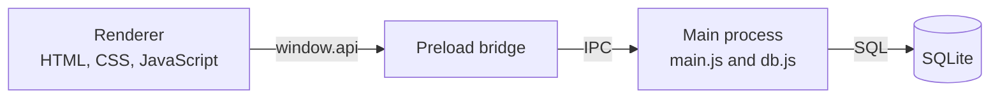

<div align="center">

# 📚 Lesson Roster

**A desktop app for keeping track of students, lessons and homework.**
Built with Electron, SQLite and plain JavaScript.


<br>


</div>

<!-- Screenshot tip: take it with the demo data loaded, in a window of about 1200 x 750 px,
     and save it as docs/screenshot-main.png. A second image (search or calendar) can go in the Gallery section. -->

---

## ✨ Features

| | Feature | Details |
|---|---|---|
| 👥 | **Student cards** | Every student has a card with their name and notes, kept in a scrollable list. |
| 🔎 | **Instant search** | Search by first name or surname. Results open in a panel that shrinks and expands on hover. |
| 🗓️ | **Quick lesson actions** | A roll-out menu on each card shows the next lesson, adds a lesson, or shows the homework. |
| ➕ | **Add a lesson** | Pick a date with a date picker. The app refuses to store the same date twice for one student. |
| 📆 | **Calendar** | A month grid with the current day highlighted and a popup per day. *(in progress)* |
| 💾 | **Local database** | All data lives in a local SQLite file, with no account and no network needed. |

## 🧱 How it works

The interface never touches the database directly. It talks to the main process through a small bridge (`window.api`), and the main process runs the SQL.



The bridge exposes a few calls such as `getStudents`, `addStudent`, `addLesson`, `getNextLesson` and `getLessonsForStudent`.

## 🛠️ Tech stack

- **Electron** for the desktop shell
- **SQLite** (`better-sqlite3`) for storage
- **Vanilla JavaScript**, with async/await for all database calls
- **HTML5 and CSS3**, with the styles split by purpose: layout, buttons and cards, calendar, theme

## 🚀 Getting started

You need [Node.js](https://nodejs.org/) (a current LTS version) and Git.

```bash
git clone https://github.com/dmytro-buniak/<repo-name>.git
cd <repo-name>
npm install
npm start
```

> **Heads-up:** `better-sqlite3` is a native module. If you see a `NODE_MODULE_VERSION` error on start, rebuild it for Electron with `npx electron-rebuild`.

The first launch creates a fresh database and fills it with **demo students**. They are fictional characters, and no real personal data is in this repository.

## 📁 Project structure

```
.
├── scripts/
│   ├── main.js        # Electron main process
│   ├── db.js          # SQLite setup and queries
│   ├── preload.js     # the window.api bridge
│   └── renderer.js    # UI logic: cards, search, popups, calendar
├── src/
│   └── index.html     # app window
├── style/
│   ├── base_containers.css   # layout containers
│   ├── buttons_cards.css     # buttons and student cards
│   ├── calendar.css          # calendar grid and popups
│   ├── minimal_green.css     # colour theme
│   └── scroll_bar.css        # custom scrollbar
├── docs/              # screenshots
├── package.json
└── README.md
```

<!-- Adjust the file names to match your repo. -->

## 🗺️ Roadmap

- [x] Student list with notes
- [x] Search by name
- [x] Next lesson, homework and add-lesson popups
- [ ] Show scheduled lessons inside the calendar *(in progress)*
- [ ] Edit and delete students and lessons

## 📝 About this project

I built Lesson Roster to learn how a desktop app fits together: a real database, a safe bridge between the interface and the data, and a UI written without a framework. This public edition uses demo data only. I'm still working on it, and the calendar is the next feature.


---

<div align="center">

Made by [Dmytro Buniak](https://github.com/dmytro-buniak)

</div>
